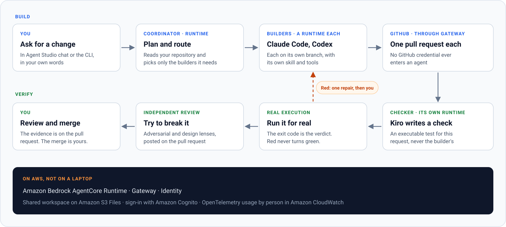
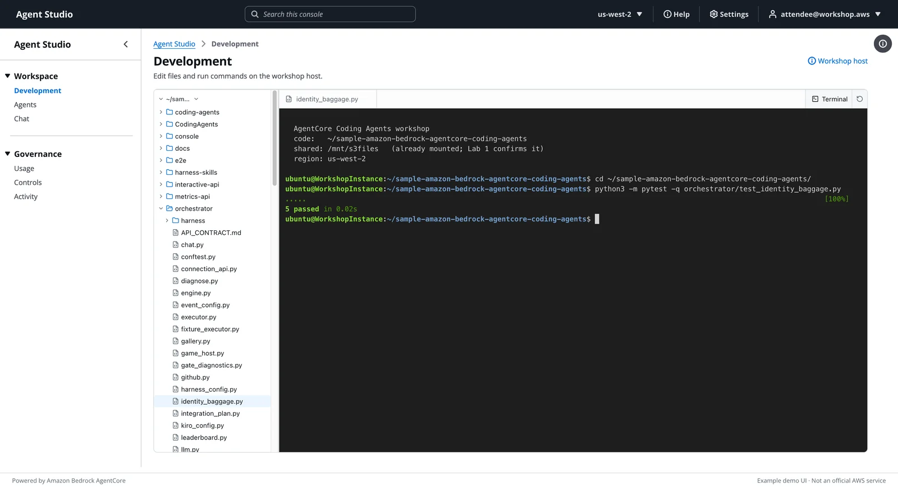
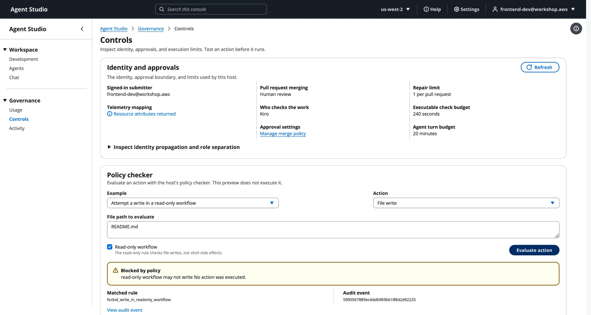
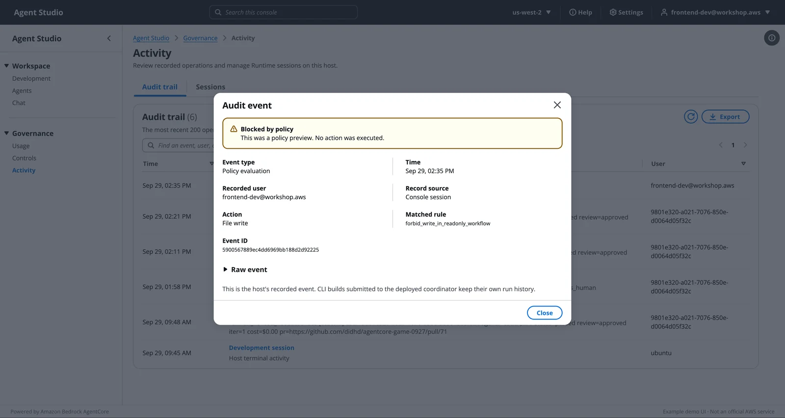
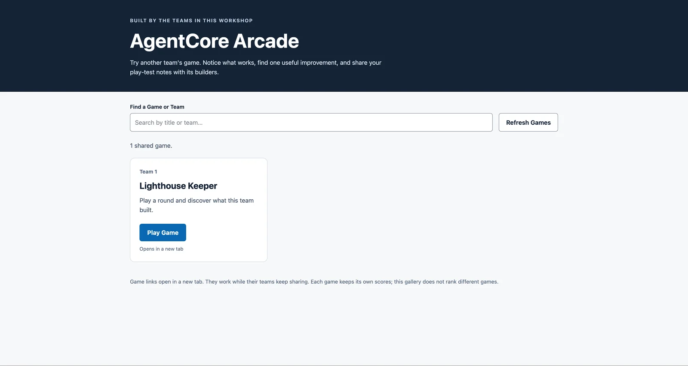

<div align="center">

# Coding Agents on Amazon Bedrock AgentCore

**Your coding agent, without your laptop's limits.**

It keeps working when you close the lid, it runs twenty at once,<br>
it wakes up on its own when your repository changes,<br>
and it works in a team where the maker is never the checker.

[Get started](#get-started) · [The four labs](#the-four-labs) · [How the team works](#how-the-team-checks-its-own-work) · [Operator notes](docs/operators.md)

<sub>The code behind the AWS re:Invent 2026 workshop <b>AIM416: Scale your coding agents beyond the laptop with AgentCore</b></sub>

</div>

## Why this exists

Claude Code, Codex, and Kiro feel best in your own terminal, and that terminal is
the limit. The agent stops when the laptop sleeps, runs one task at a time, and
waits for you to type, and it grades its own work. Amazon Bedrock AgentCore Runtime
gives every session its own microVM, so the same agent can outlive the laptop, run in
parallel, start from an event, and work beside agents from other vendors that check
it. This repository is a complete, working example.

## The four labs

**Lab 1. Run Claude Code on AgentCore Runtime.** Build Claude Code's image, create its
Runtime in the AgentCore console (**Create runtime**, an ECR image, **Create default
role**, an S3 Files mount), and open a terminal inside a new session, a microVM of its
own. Give it a task, press **Ctrl+]** to disconnect, and reconnect later to the same
conversation with the work done. Files live on the S3 Files mount, so they outlive the
session. The image's
health server (`coding-agents/healthcheck.py`) answers `/ping` with `HealthyBusy` while
the agent CLI runs, which keeps the session alive while you are disconnected; once the
CLI exits, the idle timeout applies.

```bash
docker buildx bake claude-code --push      # REGISTRY=<account>.dkr.ecr.<region>.amazonaws.com
agentcore exec --it --runtime "$ARN" --session-id "$(cat /proc/sys/kernel/random/uuid)"
```

**Lab 2. Run Many Agents in Parallel.** Twenty Claude Code agents work on one
repository at once, the way you run parallel agents on a laptop: one branch and one
Git worktree per agent (`claude -w <name>`). Here each agent is a new session, so each
worktree is on its own isolated microVM. You check the isolation by hand first: a note
written in session A cannot be read from session B. `fanout.py --init` makes your Lab 1
game a Git repository with a backlog of feature ideas and pushes it to a bare repository
on the S3 Files mount, the only Git data there. Each session clones it to its own disk,
runs `claude -w feature-NN` on one backlog item, and pushes that one branch. The host
checks every branch out as a worktree under `~/arcade`, where you play them and merge the
one you like. One rule committed to `CLAUDE.md` on `main` reaches every agent.

```bash
agentcore exec --runtime "$ARN" --session-id "$A" "sh -c 'echo hi > /tmp/note'"
agentcore exec --runtime "$ARN" --session-id "$B" "cat /tmp/note"   # No such file
python3 coding-agents/fanout.py --init && python3 coding-agents/fanout.py --agents 20
python3 coding-agents/fanout.py --repo ~/your-repo --init   # then --repo ~/your-repo --task "... {n} ..."
```

**Lab 3. Run an Agent on Every Pull Request.** Connect a GitHub repository and open a
pull request. GitHub's
event reaches the endpoint you deploy, which checks its signature, acts on each signed
event once within an hour, and starts a new session that reviews the change, runs the
code to prove what it finds, and posts the review on the pull request. Only pull
requests from people the repository trusts are reviewed, because the review runs the
code. Add `REVIEW.md` to the default branch to set your team's rules; comment
`/fix` and a fixer session opens a fix pull request that a different session
reviews. No agent ever holds a GitHub token: every write goes through AgentCore
Gateway.

```bash
aws cloudformation deploy --template-file /tmp/pr-review.yaml --stack-name coding-agents-pr-review \
  --capabilities CAPABILITY_NAMED_IAM   # after cloudformation package of coding-agents/pr_review/template.yaml
./connect-github.sh owner/repository   # two clicks on GitHub: Create, Install
```

The reviewer is one file, [`coding-agents/pr_review/handler.py`](coding-agents/pr_review/handler.py);
its prompt is where your team's checklist goes.

**Lab 4. Build with a Team of Agents.** The same Runtime pattern serves Codex and Kiro,
and a coordinator in its own Runtime turns them into a team. One request: Claude Code builds
the service and Codex the page, one pull request each; Kiro writes and runs a check
for each; an independent review reads each; a red result goes back to its builder
once. Green, approved work merges in order, and anything still red waits for you.

```bash
cd orchestrator-agent
WORKSHOP_MERGE_POLICY=auto ./deploy-coordinator.sh   # wired to the three Runtimes and your repository
./ask.sh "Use preset=team-game. Creative direction: <your idea>"   # then: python3 ../orchestrator/watch_run.py
```

## How the team checks its own work

You ask for a change and get back pull requests that a separate agent tested and an
independent review read.

<p align="center">
  <picture>
    <source media="(prefers-reduced-motion: reduce)" srcset="docs/assets/demo-poster.png">
    <source type="image/webp" srcset="docs/assets/demo.webp">
    
  </picture>
</p>
<p align="center"><sub>Real screens from one live workshop event, in loop order. Nothing is mocked.</sub></p>

**Discover → Plan → Execute → Verify → Iterate.** A loop is only as good as its
verify step, so every choice here protects it.

- **The maker is never the checker.** Builders write code. A different agent, in its
  own Runtime with its own instructions, decides whether it works.
- **Verification is real execution.** The checker writes an executable test for
  *your* request. The engine runs it and reads the exit code. A red check never
  turns green, and no result is ever faked.
- **Bounded, then a human.** A failed check goes back to the builder that owns it
  once, on the same pull request. Then the loop stops and hands you the evidence.
- **Skills, not scripts.** Agents read principle-based skills and choose their own
  files, language, and structure. Nothing in this repository encodes the answer.

<p align="center"></p>

## Agent Studio

A browser console for the whole loop, included in [`console/`](console). The core
workshop uses the terminal; the Agent Studio track brings the same work into a
browser, with usage and controls per person.

| Workspace | Governance |
|---|---|
| **Chat** · ask, plan, and follow each build to its pull request | **Usage** · token usage by agent and by person, from CloudWatch |
| **Agents** · open a live terminal in any agent's Runtime session, or watch the one Chat started | **Controls** · identity, role boundaries, merge policy, and a policy checker |
| **Development** · edit files and run commands on the workshop host | **Activity** · an audit trail of decisions, and every Runtime session |

<details>
<summary><b>See more screens</b></summary>
<br>

**Development.** The workshop host in your browser: files, editor, and a terminal.



**Controls.** Who is signed in, who checks the work, the merge and repair limits, and a policy check that blocked a write without running it.



**Activity.** The audit record for that decision: who, which rule, and that nothing was executed.



**Event gallery.** Teams publish what their agents built so the room can play it.



</details>

## Get started

**At AWS re:Invent 2026 (AIM416) or another AWS event:** your account and a
browser-based VS Code are ready, with an empty home folder. Open the workshop and start
with Getting Started (At an AWS Guided Event), where you clone this repository at the
commit the workshop was tested with:

```bash
git clone --depth 1 --revision <commit> https://github.com/aws-samples/sample-amazon-bedrock-agentcore-coding-agents.git
cd sample-amazon-bedrock-agentcore-coding-agents && coding-agents/infra/setup.sh
```

**In your own AWS account:** launch the workshop stack in one region, then follow
the same pages. You need Amazon Bedrock access to Claude Sonnet 5.5 (and, for Lab 4,
Claude Opus 5.5 and GPT-6.1 Sol), and a GitHub account for Labs 3 and 4.

<p>
  <a href="https://us-west-2.console.aws.amazon.com/cloudformation/home?region=us-west-2#/stacks/create/review?templateURL=https://ws-assets-prod-iad-r-pdx-f3b3f9f1a7d6a3d0.s3.us-west-2.amazonaws.com/7b1cc169-b7a2-4a64-b215-df050bd8c8f1/cfn.yaml&stackName=coding-agents-workshop&param_AssetsBucketName=ws-assets-prod-iad-r-pdx-f3b3f9f1a7d6a3d0&param_AssetsBucketPrefix=7b1cc169-b7a2-4a64-b215-df050bd8c8f1"></a>&nbsp; US West (Oregon), recommended<br>
  <a href="https://us-east-1.console.aws.amazon.com/cloudformation/home?region=us-east-1#/stacks/create/review?templateURL=https://ws-assets-prod-iad-r-iad-ed304a55c2ca1aee.s3.us-east-1.amazonaws.com/7b1cc169-b7a2-4a64-b215-df050bd8c8f1/cfn.yaml&stackName=coding-agents-workshop&param_AssetsBucketName=ws-assets-prod-iad-r-iad-ed304a55c2ca1aee&param_AssetsBucketPrefix=7b1cc169-b7a2-4a64-b215-df050bd8c8f1"></a>&nbsp; US East (N. Virginia)
</p>

| Lab | You do | You learn |
|---|---|---|
| **Lab 1. Run Claude Code on AgentCore Runtime** | Build Claude Code's image, create its Runtime, give it a task, disconnect, reconnect | A session is a microVM in the cloud, so it keeps running after you disconnect |
| **Lab 2. Run Many Agents in Parallel** | Run twenty agents on one repository, a branch and worktree each, then merge the one you like | Each new session is a new isolated microVM, so running more agents is a loop over session IDs |
| **Lab 3. Run an Agent on Every Pull Request** | Deploy the endpoint, connect a repository, open a pull request | A GitHub event can start a session, and the agent never holds a GitHub token |
| **Lab 4. Build with a Team of Agents** | Set up Kiro, then send one request to a coordinator | A separate agent writes the check, its exit code decides, and a person merges |

Lost at any point? One read-only command says where you are and what to run next:

```bash
python3 orchestrator/progress.py
```

When you finish, `aws bedrock-agentcore stop-runtime-session` ends your session. In your own account,
follow the workshop's cleanup steps: the host, Runtimes, Gateway, and NAT gateway
are billed while they exist.

## What's in the repository

| Folder | What it holds |
|---|---|
| [`coding-agents/`](coding-agents) | One folder per agent (container, steering, deploy), `fanout.py`, the pull request reviewer and its template, and the GitHub Gateway |
| [`orchestrator/`](orchestrator) | The loop: routing, dispatch, checks, review, GitHub, and saved run records |
| [`orchestrator-agent/`](orchestrator-agent) | The coordinator, packaged for AgentCore Runtime |
| [`console/`](console) | Agent Studio (React and FastAPI) |
| [`harness-skills/`](harness-skills) | The skills each agent reads |
| [`interactive-api/`](interactive-api), [`metrics-api/`](metrics-api) | Terminal sessions and usage queries behind the console |
| [`e2e/`](e2e) | Journey and integration tests |

Pins, tests, troubleshooting, and hard-won gotchas are in
[docs/operators.md](docs/operators.md).

## Security

This is sample code for learning. Agent Studio is an example UI, not an AWS
service. Review IAM scope, networking, and data handling before using any of it
in production. To report a security issue, use
[AWS vulnerability reporting](https://aws.amazon.com/security/vulnerability-reporting/)
rather than a public issue. See [CONTRIBUTING](CONTRIBUTING.md).

## License

MIT-0. See [LICENSE](LICENSE).
